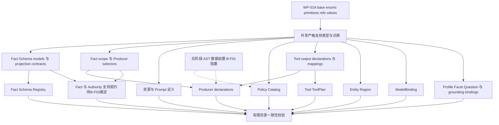

# WP-01B — Definition & Fact Registry 实施计划

Revision: PLAN-1.1（Sol Challenge 后修订），2026-11-17。状态：**PROPOSED / CONDITIONAL / PENDING_USER_APPROVAL**。
本轮仅规划；`STATIC_REVIEW_ONLY / TEST_NOT_RUN / RUNTIME_NOT_RUN`。
本文件是当前 WP-01B 唯一实施计划。`FINDINGS.md` 是其阻塞项附录，reviews/ 是只读输入和 Challenge，不能单独扩大本计划范围。

## 1. 基线、授权与本轮交付

- Repository：`krisandchris/JIMU_Inspection_Runtime`；分支 `main`。
- 实际 HEAD：`51a10416d882fe85e5a1cfc5440eac6498fc48f4`，与用户指定一致。
- WP-01A 已由 PR #1 合并，父提交为 `827fa77…`、`d3978c7…`；B 不沿用旧实施基线。
- 初始 143 个 tracked 文件逐字节等于 HEAD；没有 staged/unstaged tracked 修改。11 个既有 untracked 验收/合并文档属于已知前序交付，摘要一致，保留不动。完整路径及 SHA-256 见 `baseline.json`。
- 用户已批准 D01–D15 当前契约，且确认 A 验收/合并。旧规格和 ADR 中的 pending 标签是历史审查状态，不要求重复批准这些既有决策，也不重写历史。
- 本次用户**只授权 B Planning**。整体 A/B/C 方向批准不能替代本计划审批。以下 Finding 的建议尚未批准；实施、安装、测试均未开始。Commit、Push、分支、PR、Merge、部署仍分别受授权门禁控制。

已重新阅读 AGENTS、README、四份规格、ADR/roadmap/dependencies/test strategy、WP-01 总计划、全部四个示例；直接检查 A 全部源码、公开接口、配置及相关测试/证据。可选 `ENGINEERING_EXECUTION_AND_ACCEPTANCE_STANDARD_V1.0.md` 当前不存在，不补造。
目录已有 src layout、7 个 Python 源文件、7 个测试 Python 文件、fixture、CPU 锁文件及历史审计包；没有 Definition、Fact Registry、Rule AST 实现。

本轮只新增 `planning/active/WP-01B/` 内的计划、Finding、审查记录和字节证据。旧规格、A 源码/测试/配置、全部历史审计材料不修改。当前 324 passed 是 A 历史测试结果，不是本轮运行结果。

## 2. 多智能体能力与实际配置

| 检查项 | 实际证据与结论 |
|---|---|
| Codex 版本 | `codex --version` → `codex-cli 0.169.0` |
| 原生 Multi-Agent | `collaboration.spawn_agent/list_agents/send_message/followup_task` 可用；本轮实际启动 A–D 四个只读子任务并收取结果 |
| 每任务模型/effort 覆盖 | spawn 显式 `fork_turns=none, model=gpt-6.1-sol, reasoning_effort=medium`；四个原生子会话 turn_context 均核对相符 |
| Primary | 当前 turn_context 为 `gpt-6-astra / xhigh`；按用户条件条款的 xhigh 执行，未把标题中的 Ultra 冒充实际 ultra |
| 配置规范 | 使用本机版本的 CLI help 和导出的 app-server protocol Schema；其 TurnStartParams 明确 model/effort。`codex --strict-config app-server --print-startup-config` exit 0。没有猜字段、修改 config 或安装框架 |
| 运行状态 | 原生 list_agents 实际返回四任务 running，随后取得四项完成回复；可定向 followup/interrupt |
| 文件系统 | 四子会话 cwd 与主会话相同，实际读取同一 HEAD/工作区；共享文件系统，无隔离写入假设 |
| Worktree | CLI 有 `--worktree`，原生工具有创建/查询 managed worktree；当前 Git 只有主工作树，managed inventory 为空。支持接口存在，**创建验证未执行**；spawn 无独立 worktree 参数 |

安全白名单元数据见 `orchestration_verification.json`。子任务自身报告“无法核对 model”保留原样；Primary 后续直接核查原生会话记录确认模型，不将子任务自述当配置证据。旧 feature flag 的 deprecated/false 状态不能替代本轮实际 spawn 和 turn_context 证据。

本轮采用“一名 Astra 主控 + Sol 开发角色的四个只读任务”，并非四个写入者。未来实施同一时刻只运行一个 Sol 写入任务，Primary 在其结束后审查/修改。独立只读工作可以并行。无需替代 Agent 框架。
未来若选择独立 worktree，须在 Git 授权中明确目标 ref/分支和目录，由 Primary 创建或复用后逐任务指定路径；不复制未提交变更、不同时写主树。当前不创建 worktree/分支。

## 3. 目标、非目标与不可绕过的阻塞

目标是用户列出的八项：Entity/Region；Profile/Facet/Question；ModelBinding/Tool/ToolPlan；Policy Catalog；FactSchemaDefinition；FactProducerDeclaration；AuthoritativeResultSelection；Fact Schema Registry。仅不可变数据模型、有限注入目录的纯校验、Schema 与 CPU 测试；不建设外部服务。

不实施 Rule AST、Rule TypeChecker、Rule Evaluator、Applicability Gate、Bundle compiler/完整 closure/digest/signature、Release Manager、Workflow、DB/ORM、API、Model Gateway、GPU/模型调用、需求平台适配。不会新增 ArtifactKind/PolicyKind 或修改已验收 A 的数值/引用语义。

**当前八项完整目标不能在所有现有限制下直接实现。** Policy 中必填 AST 与 B 禁 AST 有实际依赖冲突；还有必须冻结的字段/引用边界。发现冲突后停止相关设计落地与实现，不修改规格或以占位类型填补。继续完成本次明确授权的 Finding、可审查选项与计划。

| Finding | 影响与门禁 | 当前状态 |
|---|---|---|
| B-F01 | 完整 16 Policy、conditional Producer 依赖 AST；B 明确禁 AST；需用户裁定阶段依赖 | BLOCKING / OPEN |
| B-F02 | TypeDefinition→value_schema 的 JCS/input digest 与 B/WP-02 边界；不能用 stable_json 冒充 | BLOCKING 对完整 F04 生成验收 / OPEN |
| B-F03 | Authority 三组 result kind、group identity、Facts/Attempt 校验输入与 B runtime-support 范围 | BLOCKING / OPEN |
| B-F04 | ontology 分类/lifecycle、metadata、Context selectors、Tool mappings、Schema 路径环境等 wire 细节未冻结 | BLOCKING 对相关模型/语义验收 / OPEN |
| B-F05 | 跨阶段 RuleSet/完整图检查不能由有限目录冒充；各层验证证据须分开 | 计划已明确边界；实现仍待核验 |
| B-F06 | A import DAG 测试对子模块 `ImportFrom` 边的覆盖不足 | 已纳入 B 测试改进提案；本轮未改测试 |

完整证据、候选取舍和关闭条件见 [FINDINGS.md](FINDINGS.md)。这些不是重新审议 D01–D15；本轮不产生新的已确认业务决定。

建议先一次性裁定 B-F01–04，再批准带冻结字段附录的本计划；不能一句“开始实现”隐式选中尚未确认的方案。若用户调整 B/C 分期，必须更新交付清单和验收表后复核，不能把缩减的交付标为原完整 B PASS。

## 4. WP-01A 复用与兼容边界

| 既有公开接口 | B 的使用方式与限制 |
|---|---|
| `domain.base.ContractModel` | 复用 strict/frozen/extra forbid/revalidate；新增持久根显式 schema_version；tuple/只读 map 保证深不可变，不能只依赖 frozen |
| `ArtifactId/RecordId/Version/Digest` | 复用 exact stable SemVer、小写 64 hex、不 coercion；不引入并行身份体系 |
| `ArtifactKind` 25 / `RuntimeRecordKind` 26 | 保持集合与 wire；字段增加 expected-kind 约束，不自行加 system_result 等 kind |
| `ContentRef` | 四字段 `artifact_kind/artifact_id/version/digest`；定义不含自己的 digest；kind 正确仅证明形状 |
| `IdentitySelector` | 只允许 Profile/Region applicability 身份；不当执行依赖或 membership，不转换成已验证 ContentRef |
| `SchemaRef` | ContentRef 子类型，另外必填完整 2020-12 dialect URI；只在明确要求 SchemaRef 的字段使用，不把所有 ContentRef 自动升级 |
| `RuntimeRecordRef` | kind/id 需通过拥有者的 Execution/Profile/Object scope 校验；不会自然保证全局身份唯一 |
| `Value/TypeDefinition/ValueContract/validate_typed_value` | 直接复用七分支和 4096/256/64/8 边界；Schema 必须来自已注入可信定义，不能接受 payload 自带约束作为权威 |
| 独立六状态域 | 沿用，不创建宽泛 status 枚举；必要新枚举只来自已批准 Domain 列表 |
| `stable_json()` | 比较序列化，不是 JCS 或任何内容真实性证明 |

保留外审 F01：JSON Schema integer 可接受 1.0、number 可接受整数 1，A 的严格 Python Integer/Number 分别拒绝这些表示；不得为表面一致放宽 A。验证流水线必须区分 Schema 结构与严格语义，并单列预期差异。

普通 ContentRef 与 SchemaRef 的内容身份比较取四元组，dialect 另行校验；不能依赖两个不同 Pydantic 类的对象相等性，也不能为比较而丢掉非法附加字段。新增字段收紧旧模型属于兼容变更；当前计划不授权重写 A。

## 5. 模块依赖 DAG 与实现顺序

箭头表示“前置被后者使用”，是 Python 模块层依赖，不是 Runtime 工作流或 Rule AST。



跨定义关系用 ContentRef，不以内嵌 Profile/Question/Tool 模型互相 import。共享 selector、外部能力/审计引用、单位等支持类型不依赖完整定义。模型 validator 只做局部不变量；跨模型验证统一在上层 validation，不让底层反向导入 Registry/definition validators。Registry 不导入 Rule/Bundle/Workflow。`__init__.py` 不全量重导出。

用户建议的 B.1–B.6 是业务子任务名称，可按依赖调整执行顺序：

| 顺序 | 子任务 / 唯一写入者 | 前置与交付 | Primary 定向验收 |
|---|---|---|---|
| 0 | PLAN → CHALLENGE → USER APPROVAL | B-F01–04 关闭、字段附录冻结、允许文件确定、实际 HEAD/既有文档状态重核 | 未满足则不委派代码 |
| 1 | B.1 Ontology + shared support / Sol | 基础公共支持类型、Entity/Region、必要静态资源形状、有限 schema_descriptors/review_inputs | refs/版本/不可变与分类字段负例；后续Tool路径/Provider检查所需typed输入先存在 |
| 2 | B.5a Fact Schema / selectors / Tool outputs / Sol | FactSchemaDefinition、projection 输入、scope/producer selectors、独立 ToolFactOutputDeclaration/Mapping | TypeDefinition 复用、精确 schema identity、无父摘要环；B.3 所需输出类型先交付 |
| 3 | B.4 Policy Catalog / Sol | 已裁定完整范围；保持 16 种最终契约，不以子集冒充 | 所有分支显式字段；B-F01 关闭才交完整 union |
| 4 | B.3 Model / Tool / ToolPlan / Sol | policy refs、schema descriptors、命名输出和映射字段冻结 | remote primary、输出路径、step identities；无调度 |
| 5 | B.2 Capability Definitions / Sol | Profile/Facet/Question、Prompt、grounding binding | 精确 Facet 交集、Profile context、Question 一个 primary |
| 6 | B.5b Producer / Authority / Sol | 生产关系、碰撞域、B-F03 批准的数据支持范围 | whole-batch/step、历史候选、显式 revision；无 CAS |
| 7 | B.6 Fact Registry / cross-validation / Sol | finite immutable registry + 跨定义校验 | 只读解析、scope/producer/path、无 global mutable state |
| 8 | 完整测试与 Primary Review | 单一最终源码快照、完整 A+B 回归和质量/Schema 证据 | Primary 直接读源码/diff/原始输出，必要时定向整改 |

B.5a 先于业务定义是类型依赖要求，不是提前建设 Registry 服务。ToolDefinition 与 ProducerDeclaration 均导入同一低层 `tool_outputs.py`，Tool 不依赖尚未实施的 B.5b；禁止临时复制输出模型。每个子任务仅运行其获准相关测试；所有任务完成后统一完整测试，代码变更后重跑受影响检查。不存在“Sol 完成即 WP 通过”。

## 6. Pydantic Schema 交付清单与文件归属

标记：**TARGET** 是 B 完整目标；**SUPPORT** 是目标所需的支持契约，需在审批时纳入；**BLOCKED** 指相应 Finding 未关闭，禁止占位实现；**DEFERRED** 不属于本次实现。
所有持久根必须 `schema_version` 显式、无默认；建议首版 `1.0.0` 作为计划候选，须随 B-F04 一次冻结，不从包版本 0.1.0 推导。嵌套 union 在所属根治理，不能凭空成为新 ArtifactKind。

| 逻辑文件（相对 src/jimu_runtime/domain/） | 模型 / Schema 清单 | 状态与依据 |
|---|---|---|
| `definition_support.py` | ReviewReportRef、ExternalCapabilityRequirement、VocabularyMemberRef、VersionConstraint、ContextFieldSelector、受限 path/UTC/budget types | SUPPORT；Domain §9/14；Context/source 与单位细节 B-F04 |
| `validation/issues.py` | ValidationIssue、有限 ValidationReport（含检查范围/未执行检查） | SUPPORT；错误码/path/相关 refs 有界，非持久运行事件 |
| `definitions/ontology.py` | EntityDefinition、RegionDefinition | TARGET；§3.1–3.2；分类/lifecycle B-F04 |
| `definitions/resources.py` | VocabularyDefinition、StaticAssetDescriptor；GeometryResourceDefinition 仅在批准明确几何形状后 | SUPPORT；§9；Region.geometry_ref 可先保留精确引用，不能称几何语义已验收 |
| `definitions/prompts.py` | PromptTemplateDefinition、PromptVariable | SUPPORT；§10；placeholder/path/partial 契约 B-F04；无 renderer |
| `definitions/capabilities.py` | ProfileDefinition、FacetDefinition、QuestionDefinition、ModelGroundingBinding、ToolGroundingBinding | TARGET；§3/10/12；无反向 Profile 字段；可选 mappings B-F04 |
| `definitions/models.py` | ModelBinding | TARGET；§3.9/10；exact IO、capability 和 policy refs |
| `definitions/tools.py` | ToolDefinition、ToolPlanDefinition、ToolStep、StepDependency、InputBinding、OutputBinding | TARGET；§3.6–3.7/13；通用 mappings B-F04。不新增重复 ConditionalBranch 表达式体系 |
| `policies.py` | PolicyArtifact（最终16分支 union），下表全部 Policy；ContextSelectionRule、SelectionCallPolicy、SharedN02SelectionCallPolicy、AdditionalSelectionCallPolicy、ContextFieldRequirement、DeploymentRequirement、FallbackTransition、LocalPrimaryException | TARGET/SUPPORT；§3.9.1/11.1/14；其中 AST 分支 B-F01 BLOCKED |
| `fact_schemas/models.py` | FactSchemaDefinition、GlobalTypeLimits、ValueSchemaGenerationSpec、TypeDefinitionProjection、ValueSchemaGenerationInput、FactSchemaCatalogue、ResolvedFieldType | TARGET/SUPPORT；§12.1；复用 A TypeDefinition，不复制第二套自由代数；路径可选性返回记录受 B-F04 冻结；B-F02/04 |
| `fact_selectors.py` | FactScope（object/execution 类型数据）、FactSelector、QuestionProducerSelector、ToolProducerSelector、SystemProducerSelector、ProducerSelector union | SUPPORT；§13.3；无 AST Expr/运行解析器 |
| `tool_outputs.py` | ToolFactOutputDeclaration、ToolFactOutputMapping | SUPPORT；§13；B.5a 交付，Tool 和 Producer 共用唯一类型，避免 B.3/B.5b 顺序环 |
| `producers.py` | ProducerCatalogue、FactProducerDeclaration、QuestionProducer、ToolStepProducer、SystemProducer | TARGET；§13；声明类型不反向 import Tool/Profile；activation_condition B-F01 |
| `runtime/authority.py` | AuthoritativeResultSelection 及 observation_batch/tool_step/system_output 三个 group 分支、ActorRef | TARGET；§13.2；B-F03 未冻结前不实现 |
| `runtime/facts.py` | FactRecord union、KnownFact、UnknownFact、ErrorFact、NotApplicableFact、NotEvaluatedFact；FactReason、Fact source/provenance 与 scope 分支 | **条件 SUPPORT**；如 B 验收要求 validate_fact/候选历史，需要 B-F03 明确批准这些字段，而非默认为八模块外无限 runtime 扩展 |
| `validation/authority.py` | 非持久有限 Fact/Attempt/Result 关联输入与校验接口（确切字段见 B-F03 关闭附录） | **条件 SUPPORT**；不可用 RuntimeRecordRef 格式检查冒充整批证明；不新造 runtime artifact |
| `validation/schema_descriptors.py` | 有限离线 Context/Attribute/Tool IO/Response 类型描述输入 | **条件 SUPPORT**；B.1提供；B-F04 冻结权威来源、字段和支持域；非任意导入 JSON Schema |
| `validation/review_inputs.py` | ReviewMetadata / TransitionAssessment 有限非持久校验输入 | **条件 SUPPORT**；B-F04 冻结版本化 source/target/capability/scope/trigger/report 覆盖及显式校验时刻；不成为真实审批记录或新Artifact |

`FactSchemaRegistration(ref, definition)` 是 Registry 构建接口的内存条目，不是新 ArtifactKind；是否需要 Pydantic 根由最终持久性要求决定，不能额外发明独立发布对象。PrimaryFactOutput 不再作为 Question 的第二权威来源：直接沿用 primary_fact_key/ref。所有新增内部 helper 必须在批准后的模型索引登记职责，避免与已有概念重复。

完整 Policy 清单：

| policy_kind / 模型 | B 静态验收要点 | 阶段依赖 |
|---|---|---|
| applicability / ApplicabilityPolicy | metadata-only、identity selectors、on_unknown=block | condition_ast：B-F01 |
| question_selection / QuestionSelectionPolicy | A/B 显式模式、mandatory/optional 分区、context/model 条件分支和 call budgets | context_rules 目标 Applicability；mandatory Rule completeness 后阶段 |
| unknown / UnknownPolicy | transport/envelope=no_fact、item error、非known无值 | 可完整建模 |
| question_validation / QuestionValidationPolicy | forbid coercion/extra、exact association、whole_fact_error | 可完整建模 |
| evidence / EvidencePolicy | required⊆allowed、retention/vocabulary、derived transform | 真实保留/访问执行不在 B |
| tool_execution / ToolExecutionPolicy | 显式预算/retry classes、whole step、条件 backoff | 不重试/调度 |
| tool_failure / ToolFailurePolicy | requirement、descendant block、optional continuation | 不执行 failure handling |
| tool_skip / ToolSkipPolicy | on_false/unknown/missing 固定策略 | condition_ast：B-F01，literal-only 不算完整 |
| resource_requirements / ResourceRequirements | cpu/remote/gpu 条件字段和正整数边界 | 建模 gpu 分支≠安装/运行 GPU |
| provider / ProviderPolicy | remote primary 或有效期/能力范围例外，唯一 primary、fallback-only 其他部署 | 预制 review 数据不证明真实授权 |
| fallback / FallbackPolicy | disabled 空配置；显式 transitions、refs、exact IO | 不宣称真实质量/路由通过 |
| rule / RulePolicy | 已批准 mandatory/unknown/required_guard/full scan 字段 | **策略数据**允许；没有 Rule/AST/执行 |
| conflict / ConflictPolicy | collect_all、early_exit=false | 无 winner/优先级/求值 |
| coverage / CoveragePolicy | 保留 conservative no_hits/no_target/partial | 不实现 Coverage 聚合或自动放行 |
| context_provenance / ContextProvenancePolicy | 来源、派生要求、时间字段条件、UTC | 不读取设备/运行派生 |
| execution / ExecutionPolicy | 固定 N01–N06 顺序、三个政策 refs/schema refs | 无工作流/Gate 执行器 |

PolicyKind 恰为 Domain §14 的16值；新增枚举仅实现已列出的 ModelCapability、ToolType/ProviderKind/CapabilityTag、ExternalCapabilityFamily/Feature、scope/producer、EvidenceType、资源/选择/调用方式/固定 NodeId 等。单值行为用 Literal；数值预算显式范围 1..2^63−1、clock tolerance 0..2^63−1，真实值由配置给出，不由 fixture 默认生产值。

不在 B 清单：RuleDefinition/RuleSetDefinition、AST节点/操作符/type checker；六节点 I/O、QuestionSelectionRecord、InvocationContractSnapshot、ModelInvocation、完整 ToolExecution/ObservationBatch、Applicability evaluation/Trace、ExecutionCoverage/Decision、Release/Activation/BundleManifest。它们的必要 ref 形状可以保存，但不能声称已实现或验证目标全部语义。B-F03 若需最小支持输入必须明确限定，不能顺势纳入上述完整记录。

## 7. 关键接口契约

### 7.1 有限目录与引用

只接受调用者显式注入的不可变 typed definitions / schema descriptors / trusted metadata；不扫描 Bundle 文件、不递归拉取依赖、不查远程平台、无“latest”。引用身份为 kind/ID/version/digest，同 kind/ID/version 的不同 digest 拒绝。普通 ContentRef 不保证 bytes 摘要已验证；输入目录须记录信任边界。

规范字段既有 wire 保留：Question.primary_fact_schema_ref、Facet.fact_schema_refs 用 expected-kind ContentRef；ModelBinding 明确要求 SchemaRef 的 IO 字段保留 dialect。每个资源/策略字段检查具体 kind/subtype。IdentitySelector 仅匹配显式已 pin Profile/Region；缺失或歧义不能升级成内容授权。

定义 validator 与有限目录 validator 分离。跨定义关系建议接口（待实施时保持同义签名）：

```text
validate_question_facets(question, facets, fact_schemas) -> ValidationReport
validate_profile_questions(profile, questions, facets, context_types, fact_schemas) -> ValidationReport
validate_model_tool_bindings(definitions, policies, schema_types, review_metadata) -> ValidationReport
validate_producer_declarations(declarations, definitions, fact_schemas, io_types) -> ValidationReport
```

这些接口不接受未类型化配置对象；缺少所需类型上下文返回结构化 incomplete/error，不能写全检查 PASS。Report 要列实际执行与 deferred check IDs。外部 review 只检验已注入元数据的一致性；信任解析、期限判定所需时刻显式传入，不读环境时钟当隐式参数。

### 7.2 Profile / Facet / Question

Question 至少一个 Facet，主 FactSchema 必须精确属于每个 Facet allowlist 的交集；相同 shape 或 union-only 不能替代。Profile 包含每个 Question 的所有 Facet，提供兼容 declared Context 环境；scope/semantic_key/units/coordinate_system/producer kinds 一致。没有 Profile 反向字段、runtime override 或跨 Profile Fact 复用。
每个 eligible Object 的一个被接受 observation Attempt、每个有效 Question 恰有一个 primary；Record 子字段不拥有独立 FactStatus。mandatory/optional 属 Profile selection policy，不能写成复用 Question 的固有属性。

### 7.3 Registry

```text
FactSchemaRegistryBuilder.register(exact_ref, definition) -> None / typed issues
FactSchemaRegistryBuilder.freeze() -> immutable FactSchemaRegistry
FactSchemaRegistry.resolve(exact_ref) -> FactSchemaDefinition / typed error
FactSchemaRegistry.validate_payload(exact_ref, raw_value) -> Value / typed issues
FactSchemaRegistry.describe_type(exact_ref, field_path=()) -> ResolvedFieldType / typed issues
```

register 必须外带 exact_ref，因为定义不能内含自己的 digest；核对 kind/ID/version、冲突和定义有效性。B-F02 未授权内容 hash 前不计算/宣称验证父制品真实性。不建全局单例；每个 pinned 配置构造独立 snapshot，freeze 后不可注册，旧 snapshot 不随新版本变更。
validate_payload 调用 A 的严格 TypeDefinition validation；False/0/0.0/空值按类型分别保留，null 不是 unknown。describe_type 仅逐段访问声明 Record 字段，空路径是整个值，禁止 JSONPath、列表动态索引/跨 Object joins。ResolvedFieldType 为非持久闭合返回记录，拟包含 type_definition、field_path、经过的 optional_ancestor_paths（含叶字段若可选）；字段在 B-F04 冻结。路径不存在返回错误，不伪造空类型；required 叶字段位于 optional 父 Record 中仍可能缺失，不能仅返回叶类型而丢掉该信息。
`validate_fact` 仅在 B-F03 冻结 FactRecord 支持范围后纳入，不能以 payload 通过代替 Fact 接受。`compare_compatibility` 不承诺自动语义推导/迁移；非精确引用不能自动替换，广义兼容比较留后阶段。

### 7.4 Producer、Fact、Authority

- QuestionProducer 的 ID/version=Question，output=primary，key/Schema 完全匹配；ToolStepProducer 的 ID/version=Tool，额外固定 ToolPlan/step/output；SystemProducer 固定注册 requirement identity/version。
- Question 1:1，Step 1:N 个唯一命名 outputs；ToolFactOutputMapping 不可 alias target key。N05 仅 object scope，execution scope 的 Fact 来自 system producer。
- value_path 相对规范 ToolResult.payload，evidence paths 相对显式 evidence section；对应 Schema descriptor 未提供不能假定路径有效。Raw JSON 不直接变 Fact。
- declaration 碰撞域：object 为 (profile exact-ref, fact_key)，execution 为所有 Profiles 共享 fact_key。即使 Schema 一样也拒绝两个 producer 竞争。
- candidate 唯一键保留 execution/scope/Object/producer（含 step/output）/fact_key/attempt；同时保留 fact_id→不可变candidate 的身份约束，不允许改Execution/Attempt/key来绕过同一ID冲突。记录ID唯一域和同内容判重字节规则在 B-F03 冻结，不把stable_json当原始bytes身份。相同键同内容可判重复，不同内容拒绝冲突；B 仅有限输入诊断，不写持久冲突事件/实现幂等服务。
- AuthoritativeResultSelection 为显式 whole observation batch / one step attempt / system output，revision 与 previous ref 连续且同组，selected Fact refs 必须匹配完整选定组。无选择或歧义时拒绝消费；不按时间、最高 confidence 或最后写入选权。ActorRef 只有 trusted human/service 类型，不允许模型输出作为选权依据。
- 完整 Fact/Attempt/Result 的字段与 result kind 见 B-F03；关联校验还需可信envelope/association状态、Attempt→NodeRun→Execution归属和显式可选权资格。完整成员集合本身不证明批次可信；超时后late结果不能自动写validated_success或改终态。各selection reason允许的资格须先冻结，不替用户决定manual_review可选范围。纯验证不证明 CAS/fencing/生产调用真实发生。

### 7.5 Schema 生成

分开两件事：(a) 全部已批准 Pydantic 根/union 的接口 JSON Schema 生成；(b) FactSchema 的受限 TypeDefinition payload projection。前者沿用 A 的离线2020-12做法；后者须满足 Domain §12.1 规范化、生成输入独立、无父 ID/digest、排序与 generation version/global_limits。
完整 F04 canonical bytes、input-derived `$id`、child digest 的实现范围等待 B-F02，不用 Pydantic API Schema 快照冒充业务 payload generator。不得将手工编辑的 Schema 当 authoritative source。

## 8. 文件分配与唯一写入规则

Primary 是本轮 `planning/active/WP-01B/**` 唯一写入者；A–D 只读。未来每次 Sol 委派都列 inputs、允许文件、输出、验证命令、阻塞退出规则；跨分工共享文件只在前一任务结束后交接。

| 未来路径 | 写入任务 | 约束 |
|---|---|---|
| `domain/enums.py` | B.1 首次，后续由 Primary 显式交接 | 只增已批准且本包必需枚举；A 集合/status 不变 |
| `domain/definition_support.py`, `domain/validation/{__init__,issues,review_inputs,schema_descriptors}.py` | B.1 | 不引入服务/宽松 map；确切字段待 B-F04；描述输入只依赖已存在基础类型 |
| `domain/definitions/{__init__,ontology,resources}.py` | B.1 | 几何内容若未冻结仅保留已批准引用边界 |
| `domain/fact_schemas/{__init__,models,projection}.py`, `domain/fact_selectors.py`, `domain/tool_outputs.py` | B.5a | projection 按 B-F02 裁定；先交 B.3 需要的输出声明/映射，不实现 Bundle hash |
| `domain/policies.py` | B.4 | 完整 union 受 B-F01 阻塞 |
| `domain/definitions/{models,tools}.py` | B.3 | Step mappings 受 B-F04 阻塞 |
| `domain/definitions/{capabilities,prompts}.py` | B.2 | 无新 Capability Registry；只已有绑定 |
| `domain/producers.py`, `domain/runtime/{__init__,facts,authority}.py`, `domain/validation/authority.py` | B.5b | runtime/facts 是 B-F03 条件交付，不默认扩围 |
| `domain/fact_schemas/registry.py`, `domain/validation/{definitions,producers}.py` | B.6 | 有限注入、无I/O/完整图准入；跨模型集成验收在此汇合 |
| `tests/unit/test_fact_registry.py`、`tests/contract/test_b_*.py`、`tests/negative/test_b_*.py`、`tests/fixtures/wp01b/**` | 相应模块 Sol；集成阶段交接 | 单一 owner，不改 A 断言去掩盖问题 |
| `tests/contract/test_dependency_boundaries.py` | B.6 | 加强子模块解析/路径边；保留 A 依赖限制 |
| `scripts/generate_schemas.py`, `schemas/generated/**` | B.6 | 若批准生成器范围；--write/--check，A 审计快照不动 |
| `planning/implementation_evidence/WP-01B/**` | 实施时 Sol 记录、Primary 审核后完成 | 原始结果追加，失败也保留；不覆盖 A/WP-00 |

包 `__init__` 仅必要空边界，不重排 A 文件结构；pyproject/uv.lock/.python-version 默认原样，无新依赖提案。若 B-F02 选择额外 canonicalizer 依赖，须先单独说明与批准有界版本，不在本计划中预授“安装最新”。规格/ADR/AGENTS 修改不在本轮文件范围；Finding 需要契约修订时先批准有限文档修订。

## 9. 测试设计与证据层次

所有下列是未来经批准执行的测试，当前 **TEST_NOT_RUN**。S=JSON Schema 结构；D=严格 Pydantic/TypeDefinition/有限目录语义；A=显式 authority 关联。预期 S接受/D拒绝单列（A外审F01），不能通过 coercion 消除差异。runtime 行为证据不由这些层代替。

| case组 / 建议文件 | 正向及边界 | 负向要求 | 执行阶段 |
|---|---|---|---|
| B-T01 `test_b_definitions.py` | 每个根最小完整/可选字段/JSON和Python往返、深不可变 | 缺schema_version/错误类型/额外secret-shell字段、反向Profile、自digest | 模块交付 |
| B-T02 `test_b_refs.py` | ContentRef字段expected kind、SchemaRef dialect、精确身份重用 | wrong kind/digest/版本、selector替代内容、重复身份异摘要、未知目标 | 模块/集成 |
| B-T03 `test_b_capabilities.py` | Question单primary、Facet精确交集、跨Profile合法定义重用 | union-only、同shape异digest、漏Facet/context、scope/units/semantic mismatch | B.2 |
| B-T04 `test_b_policies.py` | 16分支所有显式/条件字段，A/B selection mode | 默认行为、额外branch字段、mandatory遗漏、分区不完备、未注册policy | B.4；B-F01关闭 |
| B-T05 `test_b_model_tools.py` | model/tool grounding、remote primary、显式例外/回退配置、Tool多命名输出 | wrong capability、local primary越权、无review/重复deployment、report存在但不覆盖该transition/trigger/scope、disabled带transition、fact alias/路径错 | B.3局部；B.6跨模型集成 |
| B-T06 `test_b_resources.py` | budgets精确边界、UTC有效窗、source规则、显式retention | bool/0/负数/溢出、naive时间、分支字段不符、凭据/URL执行注入 | 支持模块 |
| B-T07 `test_b_fact_schema.py` | 七type含嵌套Record、单位/producer、合法小边界 | 非法enum、递归/超限、remote $ref/任意schema、父digest入projection | B.5a |
| B-T08 `test_fact_registry.py` | register/freeze/resolve、旧新snapshot并存、False/0/0.0/空字符串/列表；同叶类型的required/optional祖先路径有不同描述 | identity冲突、freeze后写、输入容器污染、implicit latest、路径不声明、optional父内required叶误报必有值 | B.6 |
| B-T09 `test_b_producers.py` | Question exactly_one、Step多输出、system execution、相同key不同Profile合法 | 重复collision domain、同schema多producer、tool execution-scope、ID/version误用Attempt、key alias | B.5b |
| B-T10 `test_b_facts.py` | 五FactStatus、object/execution、完整refs；缺optional Record字段 | known缺值/null；非known含value/null；跨scope/Object/producer/schema；bool-as-int/number | B-F03批准支持域后 |
| B-T11 `test_b_authority.py` | 整批/step、不同Attempt历史、显式选早Attempt、revision链 | cherry-pick、错result kind/Execution/Profile/Object/Attempt/NodeRun、完整但不可信批次、timeout后late冒充validated_success、无selection默认最新/最高分、断链、模型actor | B.5b；B-F03关闭 |
| B-T12 `test_b_history.py` | 同候选键相同内容重复、不同Attempt候选并存、旧selection不变 | 同键异内容、同fact_id改candidate key/bytes、不同fact_id同candidate key异内容、覆盖旧Fact、迟到candidate改已pin选择 | 纯有限数据检查，无并发/CAS |
| B-T13 `test_b_schema_generation.py` | 每个已批准根/union索引、2020-12、offline、重复生成；F04固定输入 | 根遗漏/漂移、非有限数、父子环、source顺序导致不同输出、数字舍入/环境默认 | canonical部分受B-F02 |
| B-T14 既有 `test_dependency_boundaries.py` | 实际Python模块DAG、标准库/Pydantic、子模块ImportFrom边 | cycle、Any、SDK/服务/GPU、动态执行、导入副作用、隐藏重导出边 | B.6；不实现RuleAST |
| B-T15 `test_b_examples.py` | 原示例保持 illustrative，另建正规synthetic fixture | 缺digest/version/字段、旧简写和unknown枚举状态不静默接纳 | 集成 |
| B-T16 既有 A tests | 完整324历史用例回归，确认实际最终计数 | 不删除/skip/放宽负例获取绿灯 | 完成B后的全量验收 |

Authority/producer元数据 fixture 必须标 synthetic，不能证明真实batch、评测、fallback、模型/工具调用或worker fencing。实际 AST domain typechecking、Rule mandatory完整性、Tool完整DAG/可达性、Bundle摘要、Gate/Coverage运行、N04实际调用数分别归 C/WP-02/后续运行包，不能列成 B 已通过用例。

未来执行命令（本轮未执行）：

```bash
uv run --locked --no-sync python -m pytest tests/unit tests/contract tests/negative -q --junitxml=planning/implementation_evidence/WP-01B/pytest_results.xml
uv run --locked --no-sync ruff check .
uv run --locked --no-sync ruff format --check .
uv run --locked --no-sync mypy src/jimu_runtime
uv run --locked --no-sync python scripts/generate_schemas.py --check
```

生成器当前不存在；最后一条仅在获批并交付该工具后执行，不能提前记录为成功。先记录实际环境与 lock SHA，再复用 A 锁定 CPU 环境；缺依赖时按该次实施授权判断是否允许 `uv sync --locked --group dev`，禁止自动升级/relock。A 的已验证版本为 Python3.12.3/uv0.9.15/Pydantic2.12.5/pytest8.4.2/jsonschema4.25.1/Ruff0.14.14/mypy1.18.2，当前安装状态在实施开始时重查。

每模块使用对应 test 文件的 targeted pytest，不为文档修改重跑；整个 B 一次完整验收后，仅新变更/失败/新风险触发复验。保留精确命令、cwd、UTC起止、exit、原始stdout/stderr、计数/skips与源码摘要；不得靠增加Any、ignore或省略测试满足门禁。

## 10. 双智能体任务契约与 Review

本轮 A=Ontology/Capability，B=Fact/Producer/Authority，C=Policy/Tool/Model，D=tests 四项都已只读完成，原文在 reviews/A–D。Primary 直接逐项对照 Domain、Bundle、Node、A源码/测试，未仅依据子报告判断。各子任务 Finding 统一归并为 B-F01–06，原编号仅为来源。

写成 PLAN 后，将确定 revision 的计划交 Sol 做只读 Challenge；要求指出遗漏/错分期/不可验收条目，不授予它批准权。Primary 处理后留 issue disposition、最终字节摘要及自身独立检查记录。交付结果见 `REVIEW.md` 与 `reviews/*CHALLENGE*`。

未来 Sol 实施委派固定包含：

1. 批准的 PLAN revision/HEAD、输入接口/fixtures、单任务允许文件清单。
2. 输出模型/接口及明确禁止项；共享文件 owner 转移时间点。
3. 可执行的 targeted 命令、原始日志路径、已知 Finding 和失败上报条件。
4. 发现契约不完整立即上报，不改规范/测试掩盖，不擅自分支/commit/push/部署。
5. 完成时给实际 diff/文件哈希/命令结果；Primary 读取实际文件、Git diff、JUnit/raw logs、schema index并核对测试确实覆盖契约。

Primary 对完整包做独立 Review，问题定向回派整改；审查PASS与用户最终验收分开。只有用户验收后才可考虑下一 WP，不能自动进入 C。

## 11. 可验证验收标准

| Gate | PASS 必要条件 | 当前状态 |
|---|---|---|
| G0 范围与契约冻结 | B-F01–04 关闭，确切 schema/字段/依赖/测试清单经独立审查及用户批准；无未解决阻塞 Finding | **BLOCKED** |
| G1 完整模型 | 八项目标及必要支持模型、全部获批Policy分支齐全；模型→模块→生成Schema→fixture一一映射，无占位 | NOT_IMPLEMENTED |
| G2 引用/领域 | strict/immutable/version/expected kind；精确Facet交集、Question单primary、Tool声明多Facts和唯一producer/scope | NOT_RUN |
| G3 Registry | build/freeze/精确解析/旧snapshot保持；字段路径与值严格校验；无隐式latest/覆盖/全局状态 | NOT_RUN |
| G4 Authority | 三组完整契约、候选历史、显式选定revision/完整组；错scope/Attempt/last-write-wins负例拒绝 | NOT_RUN；B-F03 |
| G5 Schema/数值 | 2020-12有效、离线、重复生成；S/D/A差异清楚；F01不弱化；F04依获批边界完成 | NOT_RUN；B-F02 |
| G6 测试与静态 | 所有必需测试实际0失败/错误/skip；A回归；Ruff check/format、mypy、完整import DAG通过 | TEST_NOT_RUN |
| G7 证据/Primary Review | 源码快照、环境/lock、原始测试/static输出、schema/hash、Findings对应实际文件；Primary独立检查 | 待实施 |
| G8 保护与停止 | A/历史证据完整、无未授权文件/业务语义/依赖/Git操作、无服务/模型/GPU/平台修改 | 本轮静态满足，实施后重核 |
| G9 用户验收 | Code/Test/Runtime/Independent Review/User Acceptance 五轴分别报告；用户明确接受B | PENDING |

Code Acceptance 未实施；Test Acceptance 未运行；Runtime Acceptance 为 RUNTIME_NOT_APPLICABLE_TO_DOMAIN_CONTRACTS / RUNTIME_NOT_RUN。未来CPU契约测试通过不表示真实Runtime、模型质量或GPU能力。不能把 TARGET 的阻塞项标DEFERRED后仍报原完整目标PASS。

## 12. 风险、回滚与审计

主要风险：AST分期矛盾被隐藏；通用Schema/Context mapping没有真实类型；引用格式被当内容可信；Authority被缩成ID检查；Schema数值数学语义覆盖严格Python语义；JCS/库版本/数值舍入引入不稳定；frozen嵌套仍可变；多Agent同时写共享文件。
控制：阻塞明确、有限typed输入、每项验收标验证层、单写入者、A回归、无隐式替代、代码与运行证据分离。部署预算、review阈值、真实provider/证据保留值仍为业务配置OPEN，不编造生产值。

当前只有新增文档，无DB/Release/平台迁移。回滚须由用户选择，仅针对本轮新增文件/未来批准的B差异；保留审计证据，不执行reset/restore/强制覆盖或删除用户文件。历史旧pending/旧HEAD是证据，不通过重写来“更新”。

本轮审计：`baseline.json` 记录143 tracked +11既有文件摘要；`orchestration_verification.json` 记录实际原生模型与协议检查；reviews/保留原始子任务结果；`REVIEW.md` 为主控核查与Challenge处置；`SHA256SUMS` 覆盖本轮交付文件（排除自身），`planning_changes.patch` 为新增文档diff（明确排除自身/摘要封套）。`verification.json` 记录保护文件核对、HEAD/工作区、未执行测试等。

## 13. 当前结论与用户决策入口

规划材料可供独立复核，**自审 CONDITIONAL，尚不具备无条件实施门槛**。A不重新开发，D01–D15不重开；B-F01–04 需要有限契约/分期裁定。推荐用户先决定 FINDINGS 的三个边界方案，并授权其相关字段表一次性冻结，随后审查更新的PLAN再授权实施；不逐文件重复审批。

本轮停止于 PLAN → CHALLENGE → USER APPROVAL。未编写 B Python/测试、未安装依赖、未运行项目测试/Schema/lint、未修改Git、未启动B实现或C。原生Sol协作调用用于工程审查，不是JIMU真实模型API集成。
